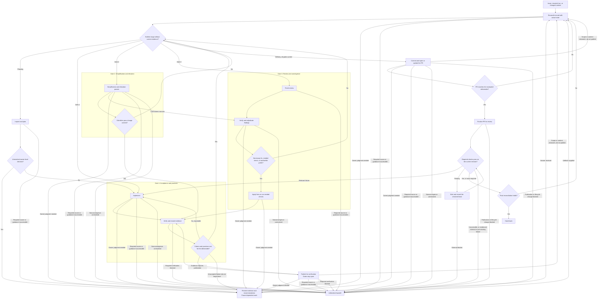

# Make It So

Pursue the issue until its final revision passes all three gates and an implementation PR is opened. Resolve supported decisions autonomously; interrupt only for material owner judgment or a real blocker. Do not settle for easy wins, shortcuts, partial acceptance, or a plan in place of delivery.

This is a workflow followed by the agent, not an executable graph engine. The graph is the only transition specification, and the section whose heading names a node ID defines its work and pass condition. Every arrow is a control transition; recording findings and follow-up candidates is a side effect, never a route around the gates. Gates are evidence conditions for a particular deliverable, not stages checked off once.

## Workflow graph

## Scope, authority, and continuity: `START`, `SYNC`

- Start from the supplied issue/specification, the selected repository, and any existing owning task or PR. Read the source rather than inferring criteria from its title. Establish the target base, full issue-related diff, relevant uncommitted/untracked work, and baseline problems. Preserve user and concurrent work, including deliberate task-related edits; identify ownership before editing overlapping changes, and separate or reconcile them rather than treating them as workflow-owned defects. Investigate intent, and ask when a deliberate edit conflicts with newer requirements and its intended resolution remains unresolved.
- Before any publication (`EARLY`, `PR`), reconcile every change in the complete prospective PR diff against the target base with the agreed scope and accepted dependencies, including commits inherited from the starting branch; task-only staging does not exclude them. Prepare a scoped branch when needed, preserving owner history and work, and take consequential dependency/scope decisions to `OWNER`. Do not publish unrelated owner work merely because it is committed.
- Follow the host's execution and delegation rules. Give any executor the issue, criteria, owner decisions, conventions, relevant skills, scope, and verification expectations; a delegate's completion claim does not pass a gate.
- A request to carry the issue through this workflow authorizes its ordinary implementation, necessary fixes, meaningful tests, commits, pushes, and opening or updating its PR within normal repository permissions. It does not authorize merging, deploying, filing follow-up issues, or messaging people. If automatically discovered during a narrower request, retain that request's narrower authority.
- Keep a lightweight, durable [run record](references/run-record.md) outside the production diff to resume, retain evidence, and deduplicate findings, not as a second project-management system. Default to `<common-dir>/make-it-so/<issue-number-or-spec-slug>.md`, where `<common-dir>` is the repository's absolute common git directory (`git rev-parse --path-format=absolute --git-common-dir`, Git 2.31+); if the host refuses it or the run may resume elsewhere, use another durable location and state its absolute path in progress reports, owner questions, and the handoff. Before creating or resuming a record, check any path the user supplies, then the default path, then its directory. When resuming and none is found, ask before starting a new record; always ask before resuming or overwriting one that names another branch or worktree. Update its status header at each gate or exit transition, owner decision, and deliverable change, and before interruption.
- At `SYNC`, reconcile the record with the actual issue, owner decisions, full PR scope and ownership, dirty and untracked work, tested snapshots, immutable branch/base revisions, PR head, and checks, distinguishing the diff's merge base from the current target-base revision. Report concrete progress without asking for routine approval between gates.

## Evidence validity: `NEXT`

Identify the deliverable by immutable target-base, merge-base, and head revisions, a fingerprint of `HEAD`'s tree with task-owned changes applied, and the issue requirements, adopted contracts, and owner decisions in force. Compute the fingerprint with the [recipe](references/run-record.md#fingerprint). Once all task-owned content is committed, a `HEAD^{tree}` that differs from it in task-owned paths, as after a hook rewrite, is a content change.

Record each check's effective snapshot and relevant configuration/dependencies, including participating preserved local changes, and a separate baseline. Mixed-worktree evidence must not silently stand in for a task-only PR: establish that it applies, or renew it in an isolated task-only snapshot without disturbing other work. Checks observing concurrent changes need a stable snapshot or renewed evidence.

`NEXT` routes to the earliest stage that is not current, continuing the recorded next action only when its evidence still applies; never resume from a stale green status. Delivery is never current across `SYNC`: with all gates current, `NEXT` re-enters at `PR`.

A task-content, material requirements/contract/decision, or relevant base/context change is an *invalidating change*. A stage is current when:

- **Planning:** the recorded plan covers the current requirements, contracts, and decisions.
- **Gate 1:** its pass condition holds for the current deliverable.
- **Gate 2:** a full round of both passes changed nothing, and no invalidating change has followed it except fixes adopted at `TRIAGE` and the Gate 1 repairs they need, not changes entered from `CI`; Gate 3 judges their simplicity.
- **Gate 3:** its pass condition holds. The clean-review count counts the latest consecutive recorded review passes that are clean, fresh, and made at the current fingerprint, or at one differing only by base changes recorded as irrelevant, with no invalidating change since.

An invalidating change therefore invalidates affected Gate 1 evidence and zeroes the clean-review count. Keep unaffected evidence only with a recorded reason; rerun unchanged checks only for a change, failure, or unresolved concern. A commit needs no retesting once inspection shows its result, after any hooks, matches the evaluated content. Missing, failed, or blocked evidence never becomes a pass.

## Skill routing

At `PLAN`, and when resuming past it, read [skill routing](references/skill-routing.md) to find companion skills by stable identifier; load only those the current node and change need. Its elevate and commit contracts govern every `code:elevate` call and commit. If required guidance is inaccessible, record the gap and unblock needed, and do not claim the dependent pass ran; never install plugins or change host configuration to satisfy routing.

## Planning: `PLAN`, `DECISION`, `OWNER`

1. Read the acceptance criteria, relevant code and behavior, repository instructions, conventions, verification commands, and [routed skills](references/skill-routing.md). Respect the adopted architecture; do not turn a focused issue into an unsolicited migration.
2. Investigate gaps through repository evidence, product behavior, platform constraints, and authoritative documentation, distinguishing observed facts from assumptions. Resolve ordinary implementation choices yourself.
3. Map every criterion to an observable pass condition, an implementation step, and suitable verification, including the required environment and checks that need a published branch or PR. Include applicable practices and regression risks, and write the plan in the run record.
4. At `DECISION`, escalate unresolved significant questions that expressly require the owner's judgment: intended user experience, accepting performance or security regressions, platform feasibility, material behavior/scope tradeoffs, or conflicting requirements. With a supported path, proceed immediately; plans need no approval.

At `OWNER`, present the issue, investigation and evidence, options and consequences, and a recommendation when one is supported, and pause dependent work until answered. Do not silently choose a regression, weaken a criterion, or pretend an impossible target is achievable. Owner questions from other nodes follow the same rule; preserve work and resume through `SYNC`.

## Gate 1 — Acceptance and practices: `IMPLEMENT`, `VERIFY`, `PASS1`, `EARLY`

Implement and verify until **all** acceptance criteria and applicable repository, language, and domain practices are satisfied with evidence. When only evidence is stale, `IMPLEMENT` changes nothing and `VERIFY` renews it.

- Exercise observable behavior across real boundaries with integration or end-to-end tests. Unit tests suffice for genuinely isolated behavior, not for a multi-component promise. Use mocks only where they do not replace the accepted behavior. Test observations must not normalize away differences the acceptance contract promises to preserve. Reuse meaningful coverage; add tests for missing evidence.
- For local-first promises, run the applicable scenarios from `local-first:local-first-design` (Validate the promises), stating expected outcomes first. Do not claim network or platform behavior from an unrepresentative substitute.
- Record the revision, tested snapshot, command or procedure, environment, expected and actual observations, and evidence for each criterion. Run required repository checks and targeted regressions. Separate pre-existing from new failures with evidence; an unexplained failure is not automatically baseline.
- Repair task-caused failures first. A required check that still fails, and also fails on the current target-base revision, is not satisfied by that baseline: reproduce it there, record the evidence, and take it to `OWNER` (accept it for Gate 1, or expand scope) rather than editing unrelated code or claiming the gate. An owner acceptance covers that check and failure mode on the recorded target-base revision, is not a requirements change or an invalidating change, and does not satisfy a required CI check.
- A green unrelated suite, skipped test, mock-only demonstration, or unavailable required test satisfies no criterion. Failed, ambiguous, or missing evidence keeps the gate open; diagnose and repair within scope, or, if verification is genuinely blocked, state the missing evidence and its unblock.
- Passing tests do not excuse violating adopted conventions or architecture; inspect practices too.

At `EARLY`, when essential evidence requires a published branch or PR-scoped environment, commit task-owned work and prepare or update the matching PR, preferring draft status when it supports the required checks. Make any needed ordinary lifecycle transition through the repository's procedure within existing authority, and describe the outstanding gates. An open or ready PR is not evidence of completion; publication does not authorize deployment or bypass approvals. Previous PR-scoped results never cover a new revision.

**Pass (`PASS1` Yes):** every criterion has passing, applicable evidence; required checks are satisfied, or the owner accepted a recorded target-base failure; relevant practices are met; no unresolved owner decision blocks the implementation.

## Gate 2 — Simplification and elevation: `IMPROVE`, `EDITED`

Run `code:elevate` under its [contract](references/skill-routing.md#elevate-contract) as two distinct passes: **simplification** examines unnecessary nesting, branching, indirection, duplication, and scattered logic; **elevation** examines legibility, boundaries, maintainability, and evidence-backed efficiency. Record each pass's outcome separately; one general verdict does not establish both.

- Improve clarity, structure, and maintainability where there is a concrete benefit, preserving **exact behavior and outputs**: public contracts, serialization, ordering, errors, side effects, persistence/synchronization semantics, accessibility behavior, and relevant timing assumptions. Fewer lines alone is not improvement.
- Repeat rounds until the pass condition holds. Do not manufacture edits or oscillate between equivalent styles; the Gate 3 cycle and nonconvergence rules apply here too, but not its stall rule.
- Tests are evidence for preservation, not permission to redefine expected behavior; do not adjust expected outputs to make cleanup pass.
- A correctness concern goes to `TRIAGE`; that cleanup inspection is not a review pass. A concern already dispositioned there stays dispositioned without new evidence. A necessary behavior correction belongs to `FIX` and renewed acceptance, not a supposedly behavior-preserving refactor; a rejected concern changes no content, so the interrupted round may continue.

**Pass (`EDITED` No):** a full round of both passes found nothing worthwhile to change in the content it examined.

## Gate 3 — Review and convergence: `REVIEW`, `TRIAGE`, `ACTION`, `FIX`

At `REVIEW`, examine the full issue-related change and necessary context, preferring fresh independent reviewer contexts; without them, run distinct fresh passes and disclose that limitation. Give each reviewer the intended deliverable, current diff/content, issue, criterion/evidence map and artifacts, adopted constraints, decision rationale, and relevant skills, never a desired verdict or earlier conclusions. Have it review evidence adequacy and applicability as well as code, and report a credible affected path, violated requirement or practice, and concrete impact, not a quota of findings. Give passes different primary risk lenses over the full scope, include a review-only `code:elevate` pass under its [contract](references/skill-routing.md#elevate-contract), and record each pass's instrument, lens, fingerprint, and what it examined.

At `TRIAGE`, independently verify every finding against code, contracts, and tests before acting. Record each finding's evidence and disposition:

| Disposition | Action |
| --- | --- |
| Necessary and in scope | Fix at `FIX`. |
| Valid but suitable for deferral | Catalog the impact, evidence, scope boundary, and why deferral is appropriate. |
| Optional polish | Apply when a concrete benefit justifies its cost and risk within scope, including renewed verification and review; keep the current form when alternatives are equivalent. Otherwise record why not now. |
| Incorrect | Reject with the disproving evidence; unresolved uncertainty is not a disproof. |
| Unsubstantiated hypothesis | Investigate against code, contracts, and a targeted check when useful. Without a supported failure mechanism or impact, record the investigation and dismiss it as unsubstantiated, not disproved. A plausible unresolved risk to acceptance still requires resolution at `FIX`, by a targeted check or a fix. |
| Owner decision required | Go to `OWNER`. |

Severity and scope are separate dimensions. Do not defer a change needed for acceptance, an introduced regression, or a problem that makes the delivered issue incorrect by calling it out of scope. An unrelated pre-existing defect can be deferred even if serious. Escalate when its consequences prevent responsible completion without an owner's tradeoff.

Adopted but unapplied fixes and needed checks carry into the next `ACTION`, after re-adjudication at `TRIAGE` if an invalidating change intervened. Deduplicate findings across passes and gates, then apply:

- **Cycle:** a finding that would undo a change applied earlier in this run, or that repeats a recorded disposition already carried out, without new evidence, keeps the earlier disposition or change; it needs no edit and does not make the pass non-clean. Necessary fixes that conflict because requirements conflict are an owner decision.
- **Stall:** once three consecutive `REVIEW` visits have each been non-clean only because of optional polish, a stall is in effect for the rest of the run: catalog that visit's and all later polish instead of applying it. That visit's passes stay non-clean; from then on, only necessary fixes and needed checks reach `ACTION` or make a later pass non-clean, and cataloged polish is not a remaining in-scope fix.
- **Nonconvergence:** a count or time limit is never a pass. If any loop keeps recurring without progress, diagnose the cause; if it cannot be resolved autonomously, go to `BLOCKED` with the log.

A clean pass leaves no unresolved necessary fix or other reasonable in-scope work, including worthwhile cheap polish until a stall; cataloged deferrals and polish not worth its cost may remain. Counted passes need fresh scrutiny: replaying a cached report, copying a verdict, or merely checking that the previous pass's fixes exist does not count. Reviewer agreement does not prove correctness or replace Gate 1 evidence.

**Pass (current at `NEXT`):** a clean-review count of at least two (the default threshold; only the owner may change it), every finding adjudicated, and no reasonable in-scope fix remaining.

## Delivery: `PR`, `MATCH`, `READY`, `CI`, `WAIT`, `FINAL`

At `PR`, use `git:commit` under its [contract](references/skill-routing.md#commit-contract) for remaining task-owned commits and create or update the issue's PR by the repository's conventions, reusing a matching PR, including one from `EARLY`. At `PR` and `EARLY`, confirm that the recomputed fingerprint is unchanged after each commit, and before pushing that it equals `HEAD^{tree}`; on any difference, including a hook that rewrote files and aborted, do not publish. Write a reviewable title and description covering the problem, resulting behavior, evidence, and material limitations. Link the PR to the session when the host supports it. No oughta skill publishes PRs; use available repository tooling within the authority above.

At `MATCH`, verify the complete PR diff against the agreed scope, and the pushed tree, branch, immutable head/target-base revisions, and PR URL against the evaluated deliverable.

At `READY`, finalize the PR for review before the final CI wait, preserving an already-ready state.

At `CI`, account for required checks, including publication- or lifecycle-triggered ones, on the actual PR/merge revision, and diagnose failures. Classify a failure as pre-existing only with Gate 1's evidence on the current target base, or as external only with direct evidence of the external cause; an unexplained failure is relevant, and relevant failures go to `IMPLEMENT` before any other goes to `BLOCKED`. A missing (required but unreported), pending, failed, or inaccessible required check is not a verified completion; treat a missing one as pending, and as an external blocker if it is neither queued nor running and cannot be triggered within authority. Establish that no checks are required from branch protection or rulesets, not from an absence of runs; if they cannot be read, the checks are inaccessible. At `WAIT`, record the head being checked.

At `FINAL`, immediately before handoff, repeat the `SYNC` reconciliation and confirm that the current PR head/base and lifecycle state still have all three gates and required CI satisfied. A green check for an earlier head, merge result, or superseded lifecycle state is insufficient, and an earlier lifecycle transition does not waive this check. External changes return through `SYNC` rather than inheriting the previous verdict. Claim completion only after this reconciliation.

## Exits: `HANDOFF`, `BLOCKED`

At `HANDOFF`, hand back:

- The opened PR and a concise explanation of what changed and why.
- Acceptance evidence, relevant automated checks, and final gate results for the delivered revision.
- Focused manual verification steps with setup and expected observations, separating additional confidence checks from any essential verification still missing, which prevents a complete claim.
- Deduplicated follow-up candidates: suggested title, observed problem and evidence, impact, proposed scope or acceptance criteria, and reason for deferral. Do not file them.

At `BLOCKED`, including PR-creation failure, keep the run unfinished. Hand back the specific blocker and unblock needed (for a pre-existing required-check failure: a fix on the target base, or an expanded scope), plus whatever exists: the PR and current head, the owning branch and worktree, any uncommitted or unpushed task-owned paths, the run-record path, evidence and gate status, manual checks, and follow-up candidates.

## Model and effort

Preserve explicit user model/effort choices. This skill does not change runtime settings itself; use only controls the host or delegation API supports, within the user's authorization, and never claim an unverified change. Gate requirements do not change with model choice. If the user permits per-stage tuning, follow [model and effort](references/model-and-effort.md).
